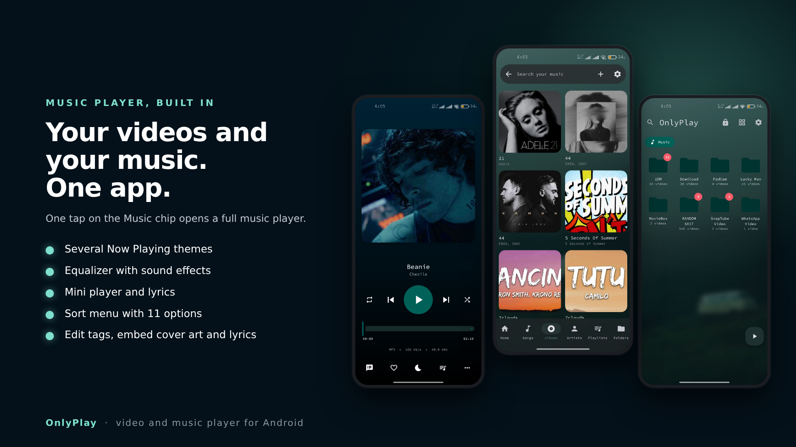
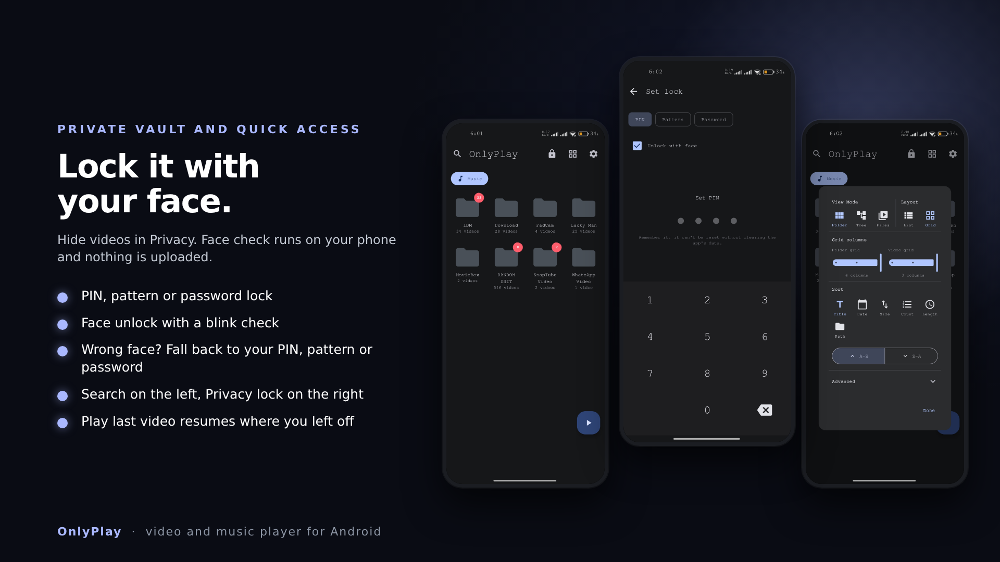
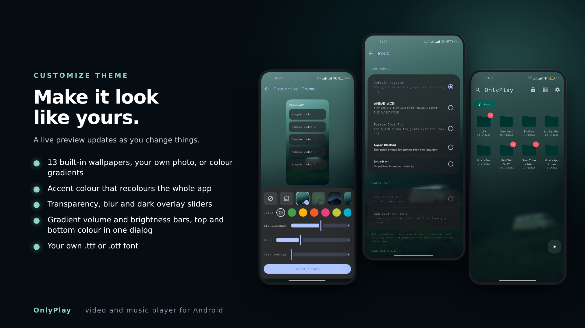

# OnlyPlay

### Your videos and your music. One app.

A video and music player for Android, created by **darkdesign69**.

**[⬇ Download the latest APK](https://github.com/darkdesign69/OnlyPlay/releases/latest)**

 

## 🎵 Music player, built in

One tap on the **Music** chip opens a full music player.

- Several **Now Playing** themes
- **Equalizer** with sound effects
- **Mini player** and **lyrics**
- **Sort menu** with 11 options
- Edit song **tags** and embed **cover art** and **lyrics** into the files

 

## 🔒 Private vault with face unlock

Hide videos in **Privacy** and lock them with a **PIN**, **pattern** or **password**.

- Unlock with your **face**. The camera check runs on your phone, you blink once to confirm it's really you, and **nothing is uploaded**
- Face not recognised? Fall back to your PIN, pattern or password

## ⚡ Home screen made for quick access

- **Search** is one tap on the left, the **Privacy lock** sits on the right
- The **Music** shortcut stays one tap away
- **Play last video** resumes where you left off
- App info shows your real release version

 

## 🎨 Make it look like yours

- Pick a background from **13 built-in wallpapers**, your own photo, or colour gradients
- Set an **accent colour** that recolours the whole app
- Adjust **transparency**, **blur** and a **dark overlay** with a live preview
- **Gradient volume and brightness bars**: choose a top and a bottom colour for each in one dialog
- Use your own **.ttf** or **.otf** font

 

## 📥 Install

1. Open the [**Releases**](https://github.com/darkdesign69/OnlyPlay/releases/latest) page.
2. Download the APK for your phone (most modern phones use **arm64**).
3. Open it and allow installs from your browser or file manager if Android asks.

 

---

Built on libmpv. Released under the license in the [`LICENSE`](LICENSE) file; original copyright notices are kept as that license requires.

